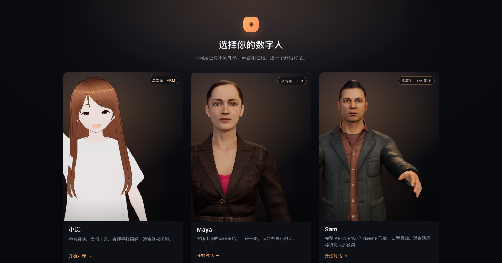
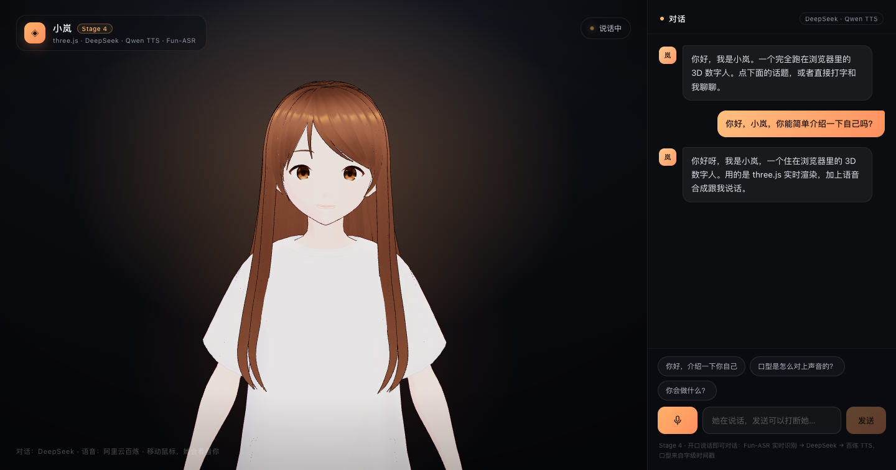
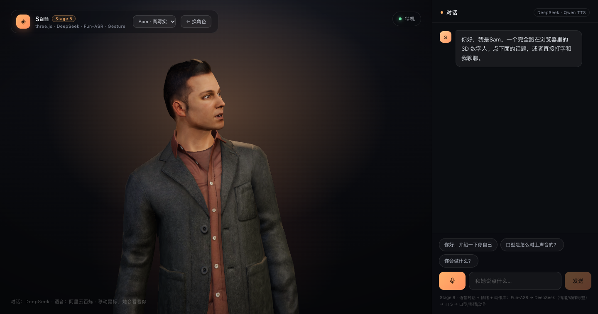

# 3d-agents

浏览器里的实时 3D 数字人 —— **Stage 8：多角色 + 选择页 + 会听、会说、有表情**。

用 Three.js 实时渲染的 VRM 数字人，会看着你、眨眼呼吸，说话时口型跟着音频走，
刷新页面先进入角色选择页，选一个数字人再开始对话。每个角色有自己的外形、设定和声音：

```
麦克风 → VAD → Fun-ASR → DeepSeek（输出 [情绪]/[动作] 标签）→ TTS → 口型 + 表情 + 动作
```







## 快速开始

```bash
cp .env.example .env      # 填两把 Key：百炼（TTS/ASR）+ DeepSeek（对话）
npm install
npm run dev               # http://127.0.0.1:5288
```

`.env` 最小配置：

```bash
DASHSCOPE_API_KEY=sk-...                 # 百炼：语音合成 + 语音识别
OPENAI_API_KEY=sk-...                    # DeepSeek：对话
OPENAI_BASE_URL=https://api.deepseek.com/v1
LLM_MODEL=deepseek-flash
```

用麦克风之前记得给浏览器**授权**；任何一边 Key 缺失都会自动降级（缺 ASR 就只能打字，
缺 TTS 用浏览器合成，缺 LLM 用本地关键词回复），页面右下角会显示当前实际链路。

```bash
npm run build     # tsc 类型检查 + 生产构建
npm run preview   # 预览构建产物（没有代理，会自动回落本地模式）
```

## 架构

```
浏览器
 ├─ three.js / three-vrm        渲染、骨骼、表情
 ├─ MicAsr                      getUserMedia → 降采样 16k → RMS VAD → PCM
 ├─ CloudTts                    WebAudio 播放 + 口型时钟（TTS 时间戳）
 ├─ 情绪解析                     [happy] 等标签 → expression + 一次性手势
 └─ ws /api/asr · ws /api/tts · fetch /api/chat
        ↕
Vite 插件（本地代理，Key 只在这里）
 ├─ server/asr.ts               → 百炼 Fun-ASR 实时识别
 ├─ server/tts.ts               → 百炼 Qwen-Audio-TTS（PCM + 字级时间戳）
 └─ server/llm.ts               → api.deepseek.com（SSE 透传）
```

## 关键实现（也是踩过的坑）

**1. 口型认音频时钟，不认字符数。**
`AudioContext.currentTime - anchor` 是唯一时间源，口型事件和音频共用它。

**2. `begin_time` 是相对整个任务的，不是相对句子的。**
按「句子起点 + begin_time」算，第二句口型会晚好几秒。

**3. `sentence-begin` 的 words 是残缺的，`sentence-end` 才是全量。**
两个都转发（`phase` 区分），前端用 `Map<index, events>` 覆盖。

**4. 关掉 DeepSeek 的 thinking，首字快 600ms。**
`deepseek-flash` 默认先吐 `reasoning_content`；请求里加 `thinking: { type: 'disabled' }`
后首字从 ~1.05s 降到 ~0.45s。

**5. 回合判定放在本地，不交给服务端。**
ASR 自带的 VAD 只负责断句；「你有没有说完」由浏览器按 `VAD_SILENCE_MS` 判断，
这样才能控制打断、也方便调手感。

**6. 保留 400ms 预滚，别吞第一个字。**
检测到说话时，把说话前缓存的音频一起发过去；注意别把当前块再发一遍（会变成「你好好」）。

**7. 打断要防回声。**
TTS 播放时把 VAD 门限抬高 2.5 倍、要求持续 4 帧才触发，否则她会把自己的声音当成你在说话。

**8. ASR 词表提升专有名词。**
`ASR_CONTEXT=小岚` 会作为领域词表传给 Fun-ASR，实测能把「小兰/小蓝」纠正成「小岚」。

**9. 表情靠标签，不靠猜。**
System prompt 要求每句开头带 `[happy]` / `[sad]` / `[thinking]` 等标签，
流式解析时把标签剥掉再显示和朗读；标签可能被切成 `[hap` + `py]`，所以清理时要顺手去掉末尾未闭合的 `[`。

**10. happy 的权重不能给满。**
VRoid 的 `happy` 预设会眯眼，给 0.75 以上她会一直闭着眼像睡着了；0.45 才是「在笑」。
说完 2.5 秒后表情自动回到平静，不然会一直挂着笑。

**11. 动作库是「语义名 + 程序化兜底」，不是动画片段。**
`[nod]` / `[shrug]` 这类标签触发一段包络，直接叠加骨骼旋转。好处是零资源、随时可调；
坏处是没有 IK，`think_chin` / `point_self` 的手部动作做不出来，只能先做头部语义动作。

## 动作库

| 标签 | 动作 | 实现 |
|---|---|---|
| `[wave]` | 打招呼挥手 | 上臂抬起 + 小臂折起 + 正弦摆动 |
| `[goodbye]` | 告别挥手 | 同上，节奏更慢 |
| `[nod]` | 点头 | 头部俯仰振荡 |
| `[shake_head]` | 摇头 | 头部左右摆动 |
| `[shrug]` | 摊手 | 双臂外张 + 头部侧倾 |
| `[think_chin]` | 思考 | 头部侧倾（手部待动作素材） |
| `[point_self]` | 指自己 | 轻微前倾（手部待动作素材） |

语义名和调度层是共享的；接 MetaHuman 后可以换成烘焙好的 clip，上层不用改。
动作时长、包络在 [gestures.ts](src/character/gestures.ts)，加动作就是加一个 case。

### 动作优先级与队列

一句话里出现多个动作标签时，由 [gestureDirector.ts](src/character/gestureDirector.ts) 调度：

| 优先级 | 动作 |
|---|---|
| 3 | `wave` / `goodbye` |
| 2 | `nod` / `shake_head` |
| 1 | `shrug` / `think_chin` / `point_self` |

- **高优先级打断低优先级**（比如说到一半跟你挥手，会立刻抬手）
- **同优先级或低优先级排队**，当前动作播完再放，队列最多 2 个，重复动作去重
- **表情不受队列影响**：标签到达立即切换，只有身体动作排队
- 新的一轮对话会清空队列（`resetEmotion()`）

## 可调参数（都在 .env）

| 变量 | 默认 | 说明 |
|---|---|---|
| `ASR_MODEL` | `fun-asr-realtime` | 实时识别模型 |
| `ASR_SAMPLE_RATE` | `16000` | 送进 ASR 的采样率 |
| `ASR_CONTEXT` | `小岚` | 领域词表，帮专有名词识别 |
| `VAD_THRESHOLD` | `0.02` | RMS 门限。安静房间 0.02；吵就调高 |
| `VAD_SILENCE_MS` | `700` | 静音多久算说完。400 灵敏，800 从容 |
| `DASHSCOPE_TTS_MODEL` | `qwen-audio-3.1-tts-flash` | 语音合成模型 |
| `DASHSCOPE_TTS_VOICE` | `longanhuan_v3.1` | 音色 |

## 目录

```
src/
  app/
    App.tsx                    # 只负责布局（~100 行）
    useCapabilities.ts         # /api/health → 三套能力开关
    useDigitalHumanSession.ts  # 对话 / 语音引擎 / 麦克风
  character/
    Character.tsx              # 每帧把语义状态喂给 adapter
    profiles.ts                # 角色清单（url / framing / license）
    createCharacter.ts         # kind → adapter 工厂
    vrm/VrmCharacter.ts        # VRM 实现
    gltf/GltfCharacter.ts      # 通用 GLB 实现（骨骼 + morph target + viseme 检测）
    gestures.ts                # 动作库（语义名 → 骨骼包络）
    driver.ts  Scene.tsx
  audio/
    engines/                   # SpeechEngine 接口 + CloudTts/BrowserTts + 工厂
    mic/MicAsr.ts              # 麦克风 + VAD + ASR 会话
    visemes.ts  vad.ts
  conversation/
    pipeline.ts                # token → 净文本 / 标签 / 语音增量（纯函数）
    tags.ts  llm.ts  mock.ts  text.ts
  components/
    ChatPanel.tsx
    CharacterSelect.tsx        # 角色选择页
  shared/types.ts
server/
  index.ts  health.ts  tts.ts  asr.ts  llm.ts
  shared/                      # 百炼域名/鉴权、WS 挂载、HTTP 小工具
public/models/sample.vrm          # 小岚（VRM）
public/models/rocketbox/maya.glb  # Maya（Rocketbox 轻量版, MIT）
public/models/rocketbox/sam.glb   # Sam（Rocketbox 完整 175 形变, MIT）
public/characters/*.jpg           # 选择页缩略图
```

## 角色

| 角色 | 类型 | 资产 | 表情能力 |
|---|---|---|---|
| 小岚 | VRM | pixiv three-vrm 示例 | 5 元音 + VRM 预设表情 |
| Maya | GLB | Microsoft Rocketbox `Female_Adult_07`（MIT） | 6 个 ARKit 形变（JawOpen / Smile / Blink / BrowInnerUp） |
| Sam | GLB | `Male_Adult_07_facial.fbx` 本地转 GLB（MIT） | **175 个形变：15 个 viseme + 48 FACS + ARKit** |

刷新页面会停在选择页；进入对话后点「← 换角色」可以返回。
切换角色会重新加载模型、清空对话历史、切换人设（`profile.persona` 会传给 LLM）。

- **Sam** 是把 Rocketbox 的 `Male_Adult_07_facial.fbx` 用 Blender 重新导出的 GLB，
  保留了全部 175 个 shape key，所以口型是 15 个 viseme 直接驱动，明显更细。
  贴图取自 coasty.ai 的同角色 WebP 版本，需要在 Blender 里把 V 轴翻转一次才对得上。
- **Sam / Maya 现在都有烘焙动画**：Idle 用 `f_idle_waiting_02`，手势用 `gestic_presentation`，
  在 Blender 里挂到同一套 Bip01 骨架上导出。Idle 循环播放，`[wave]` 时交叉淡入一段抬手手势。
  Rocketbox 动画基于 T/A-pose（手臂外张），所以每帧在动画之后用**世界空间旋转**把上臂转到自然下垂方向（绕开 Bip01 局部轴差异）；挥手时暂停这个修正。
  根骨骼的位移/旋转轨道被剥掉，避免角色走出画面或转身背对镜头。
- **Maya** 是 coasty.ai 的轻量转换版（6 个形变），口型是近似；她适合演示「换一个写实角色」。
- 两个 GLB 都会在加载时按包围盒归一化到 1.7m、脚底贴地，避免不同资产大小不一致。

资产授权见 `public/models/rocketbox/ATTRIBUTION.md` 与 `LICENSE-MICROSOFT-ROCKETBOX.txt`。

## 角色抽象（为写实路线铺路）

`CharacterAdapter` 把「角色怎么动」和「怎么对话」隔开：

```ts
interface CharacterAdapter {
  readonly object: THREE.Object3D
  load(profile: CharacterProfile, onProgress?): Promise<void>
  update(input: CharacterInput): void
  dispose(): void
}
```

- `CharacterInput` 只有语义状态：5 个元音口型、情绪、动作名、是否在说话、相机
- `CharacterProfile` 描述资产：`kind` / `url` / 取景参数 / 许可证
- 现在只有 `VrmCharacter`
- 接 MetaHuman 时新增 `MetaHumanCharacter` + 一条 profile，对话层一行不改

`driver` 是唯一的语义状态源，只在 `Character.tsx` 里被读取并喂给 adapter。
程序化动作（呼吸/眨眼/挥手）是兜底实现，任何角色都能继承这套语义。

## 测试

```bash
npm test    # vitest：情绪解析 / 对话管线 / 口型时间轴 / VAD
```

纯逻辑都拆到了不依赖 React/DOM 的模块里，所以可以直接跑单测。
## 成本

| 项目 | 单价 | 说明 |
|---|---|---|
| ASR `fun-asr-realtime` | 0.00033 元/秒 ≈ **1.2 元/小时** | 按音频时长，静音段不送就不计费 |
| TTS `qwen-audio-3.1-tts-flash` | 约 1 元/万字符 | 一条 50 字回复约 0.005 元 |
| LLM `deepseek-flash` | 按 token | 一条回复不到 0.001 元 |

每天聊 10 分钟，一个月 10 块钱上下。

## 排错

| 现象 | 原因 |
|---|---|
| 点了麦克风没反应 | 浏览器没授权 / 非 localhost 或 https（getUserMedia 限制） |
| 一直「聆听中」不出字 | `VAD_THRESHOLD` 太高，或麦克风增益太低 |
| 她说话时老是自我打断 | 外放回声，戴耳机；或把 `VAD_THRESHOLD` 调高 |
| 识别把名字听错 | 改 `ASR_CONTEXT` 里的词表 |
| `模型没接上` | DeepSeek Key/模型名/Base URL（要带 `/v1`） |
| `语音服务：上游连接失败` | 百炼 Key、是否开通语音合成、地域是否匹配 |

## 已知限制

- 外放时回声仍然会影响打断，**建议戴耳机**演示。
- 每句话单独开一个 ASR 任务，句间有 ~100ms 的连接开销。
- 麦克风采集用了 `ScriptProcessorNode`（已废弃但兼容性最好），生产建议换 AudioWorklet。
- 情绪标签依赖模型遵守 prompt，偶尔会漏或一句话多个标签（取最后一个）。
- 动作是程序化骨骼旋转，没有 IK；手部动作（摸下巴、指自己）暂时只做头部语义动作。
- Sam / Maya 的手势用的是 Rocketbox 的「展示」动画，不是标准挥手；真正挥手需要单独做一段 clip。
- 手臂下垂是在动画之后用世界空间旋转修正的（等于一份运行时 rest pose 修正），肘部仍略有弯曲。
- 两个写实 GLB 都在 20MB 左右，首次加载较慢。
- Maya 只有 6 个面部形变，口型是近似；Sam 的 175 形变版本口型更好但仍是半写实资产。
- Sam 的手臂用程序化旋转从 T-pose 放下来，姿态偏「展示」，还不是自然站姿。
- VRM 只有 5 个预设表情，复杂情绪（比如「尴尬」「得意」）只能靠组合近似。
- 口型是 5 个元音的近似；写实资产需要 ARKit 52 形状。
- 没有后处理、次表面散射、毛发物理 —— 真实感受资产与光照上限。

## 下一步

- 写实资产（MetaHuman / CC4）+ TSL 皮肤 + 后处理
- 动作库：摊手、思考摸下巴、告别挥手（现在是单个 [wave]）
- 多轮打断优化：VAD + 语义端点（semantic endpointing）

## 模型授权

`public/models/sample.vrm          # 小岚（VRM）
public/models/rocketbox/maya.glb  # Maya（Rocketbox 轻量版, MIT）
public/models/rocketbox/sam.glb   # Sam（Rocketbox 完整 175 形变, MIT）
public/characters/*.jpg           # 选择页缩略图` 来自 [pixiv/three-vrm](https://github.com/pixiv/three-vrm) 官方示例，
版权 (c) 2022 pixiv Inc.，VRM 1.0 元数据允许再分发与商用。换模型前请先读该模型的 VRM 许可证。
